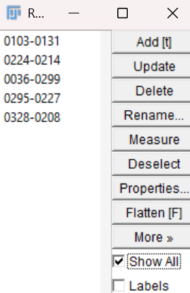
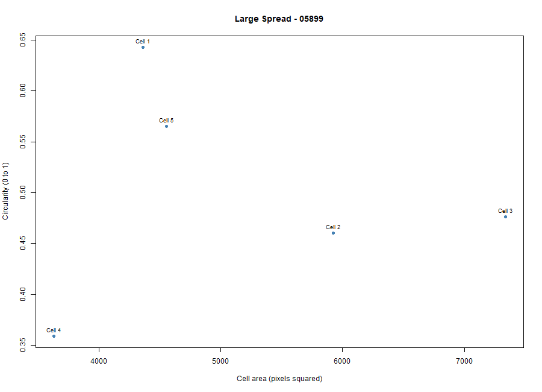
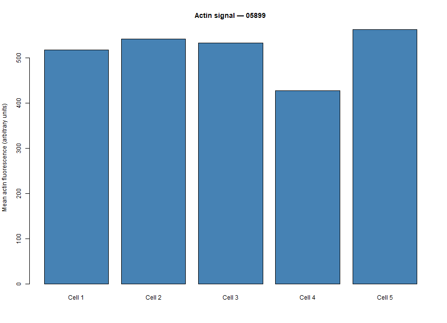

# Cytoskeleton and Cell Morphology: BBBC018 Lab

**Student ID:** 202303486

**Phenotype (my visual classification):** Large spread

**Actin file:** 05899-actin.DIB

**DNA file:** 05899-DNA.DIB

**Image field ID:** 05899

**Dataset page:** https://bbbc.broadinstitute.org/BBBC018

**Download link:** https://data.broadinstitute.org/bbbc/BBBC018/BBBC018_v1_images.zip

We used image set BBBC018v1 from the Broad Bioimage Benchmark Collection (Ljosa et al., Nature Methods, 2012).” The images are licensed CC BY-NC-SA 3.0; retain attribution when sharing image-derived screenshots.

## Fiji steps
1. Opened 05899-actin.DIB and 05899-DNA.DIB with File > Import > Bio-Formats.
2. Set Analyze > Set Measurements to Area, Mean gray value, Shape descriptors, and Display label, with Limit to threshold unchecked.
3. Traced five intact cells on the actin image with the Freehand Selection tool. I used the DNA image to check that each outline held one nucleus, and I avoided cells touching the image edge or each other.
4. Added each outline to ROI Manager (T) and measured all five (M).
5. Saved the results as `data/fiji_results.csv`. Area is in pixels² because I had no calibration. Mean is in arbitrary units.
6. Ran `scripts/analyze_cells.R` in R to make the summary table and the two plots.

## Answers

**1. Which phenotype did you choose, and what features support it?**

I chose Large spread. The cells in my field are big and flat with broad, uneven edges, and many sit apart from their neighbor cells. Since the filenames don’t come with any phenotype labels, this is my own visual classification based on what I observed in the images.

**2. Were your five cells mostly round or elongated?**

They were slightly to moderately elongated, not round and not long and thin. Mean circularity was 0.63 and mean aspect ratio was 1.46, with aspect ratios from 1.13 (Cell 1, closest to round) to 1.79 (Cell 5, the most elongated). Cell 2 had the lowest circularity (0.35) because its outline has a small jagged tip.

**3. What role does actin play in cell shape and movement (Karp Chapter 9)?**

Actin filaments under the plasma membrane help hold the cell’s shape. When actin grows at the cell edge, it pushes the membrane outward, forming the protrusions that cells use to spread and move. Actin also works with myosin proteins to generate force and tension, which lets cells contract, change shape, and pull themselves forward.

**4. Why can't a single fixed fluorescence image show how fast a cell moves?**

The cells were fixed and stained, so the image captures only one moment in time. Speed needs a cell's position at two or more known times, and a single picture can't give that information.

## Results
Summary of the five cells (`results/cell_summary.csv`):

| Cells measured | Mean area (px²) | Mean circularity | Mean aspect ratio | Mean actin signal (arbitrary units) |
|---|---|---|---|---|
| 5 | 4396.8 | 0.6312 | 1.4552 | 516.645 |

Actin signal is not compared with other image fields, because raw intensities from different fields are not directly comparable.

### Cell area vs. circularity

### Actin signal of each measured cell

## Files
- `data/fiji_results.csv`: Fiji measurements
- `scripts/analyze_cells.R`: R script
- `results/cell_summary.csv`: summary table
- `figures/`: both plots and the measured cells image8v1).
- Source: Ljosa et al. *Nature Methods* (2012). Licensed under CC BY-NC-SA 3.0.
